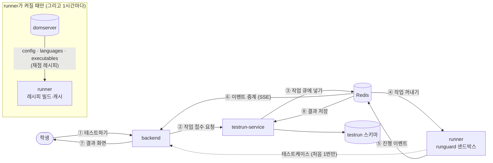
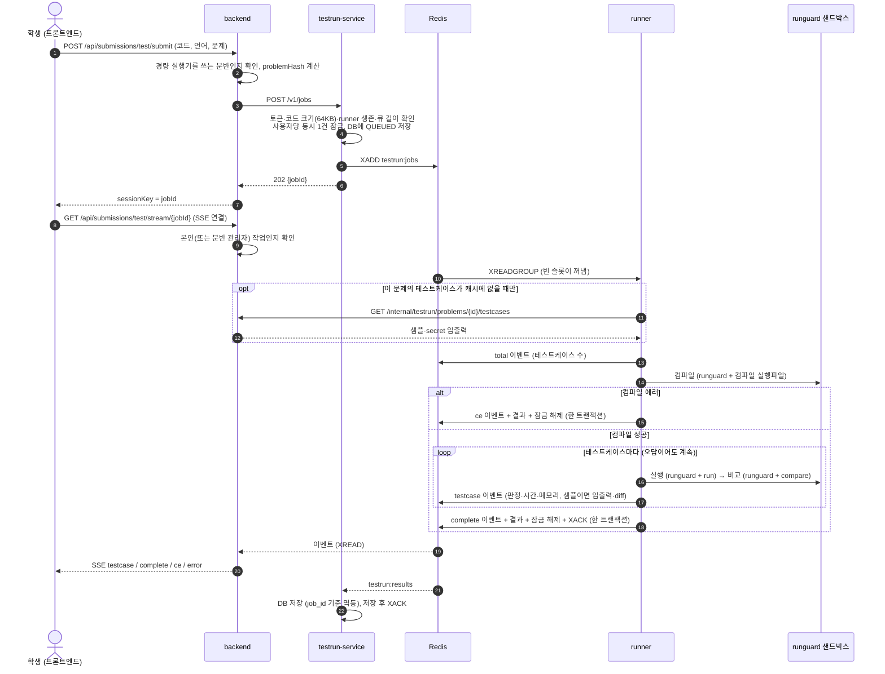
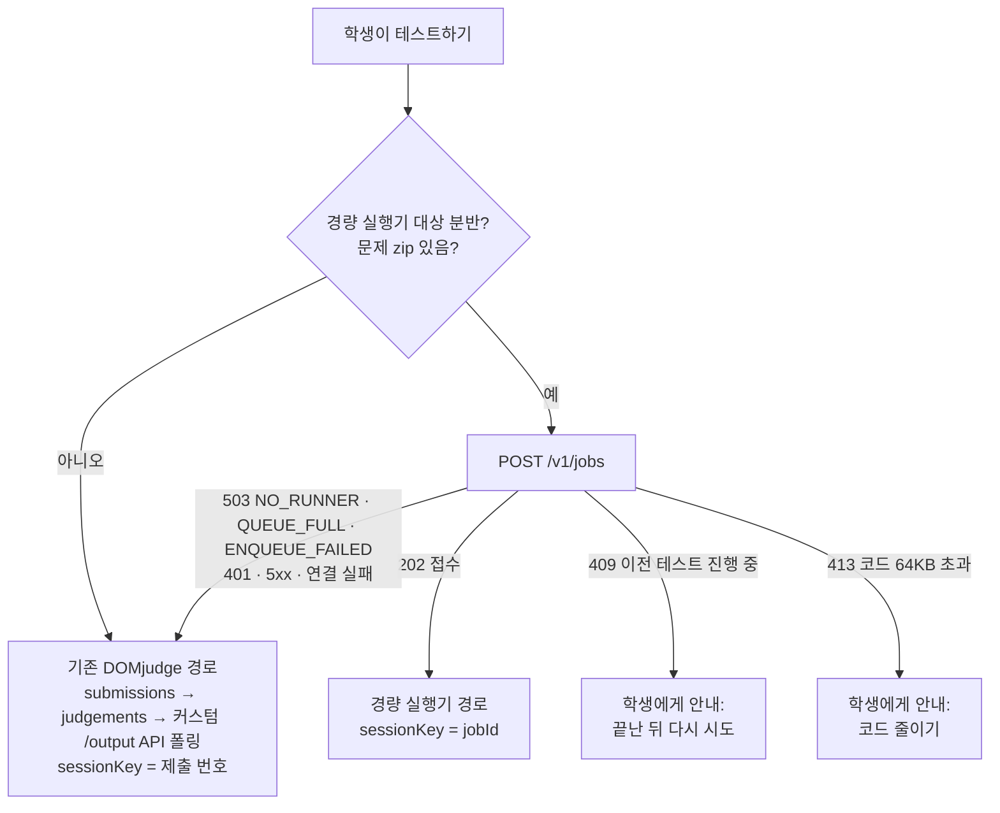

# DOMjudge 연동 정리 — 테스트하기 경량 실행기

경량 실행기(testrun)가 DOMjudge의 무엇을 쓰는지, 테스트하기를 누르면 무슨 일이 일어나는지, DOMjudge 버전을 올릴 때 무엇을 해야 하는지 정리한다.
(기준: 2026-10-28, runner `FROM domjudge/judgehost:9.0.0`, local-dev domserver `domjudge/domserver:9.0.0`)

## 한눈에

- runner는 DOMjudge **공식 REST API 3개**만 호출한다. 모두 읽기 전용이고, **기동할 때와 1시간마다** 채점 레시피(한도, 언어 설정, 컴파일·실행·비교 실행파일)를 받을 때만 쓴다. **테스트하기 1건을 처리하는 동안 domserver 호출은 0번이다.**
- DOMjudge **커스텀 API**(`/judgements/{id}/output`)는 testrun이 호출하지 않는다. 경량 실행기를 쓸 수 없을 때 backend가 넘어가는 **기존 DOMjudge 경로(폴백)**에서 쓴다.
- 학생 코드는 judgehost 이미지에 들어 있는 DOMjudge 도구(`runguard`, chroot, 컴파일·실행·비교 실행파일)로 실행한다. 이 도구들은 API가 아니라 **파일·명령행 규약**으로 묶여 있어서, 버전을 올릴 때 가장 주의해야 할 부분이다.

---

## 1. 사용하는 API

### 1.1 DOMjudge 공식 REST API (runner → domserver)

코드: `testrun-runner/.../judge/DomjudgeClient.java`, 사용처: `judge/RecipeService.java`

| API | 받는 것 | 실제로 쓰는 필드 | 쓰는 곳 |
|---|---|---|---|
| `GET /api/v4/config` | 전역 채점 설정 | `memory_limit`, `output_limit`, `process_limit`, `script_timelimit`, `script_memory_limit`, `script_filesize_limit`, `timelimit_overshoot`, `output_storage_limit`, `default_run`, `default_compare` | runguard 한도(`JudgeEnv`), hard 시간 제한(`TimeLimits`), 화면에 보낼 출력 길이, 기본 run/compare 실행파일 ID |
| `GET /api/v4/languages?strict=false` | 언어 목록 | `id`, `allow_judge`, `compile_executable_hash`, `extensions[0]`, `time_factor` | 사용할 언어 선택, 컴파일 실행파일 해시 대조, 소스 파일 확장자, 언어별 시간 배수 |
| `GET /api/v4/executables/{id}` | 실행파일 zip (base64 JSON 문자열) | zip 안의 파일과 실행 권한 비트 | `build_executable.sh`로 빌드해 컴파일(c, cpp, java_javac_detect, py3)·run·compare에 사용 |

- **호출 시점**: runner 기동 시 1회(실패하면 2초부터 최대 30초 간격으로 재시도, 성공할 때까지 준비 안 됨), 이후 1시간마다 `refresh`. 해시가 바뀐 실행파일만 새로 빌드한다.
- **인증**: Basic 인증. `DOMSERVER_USER`(기본값 `admin`)와 `DOMSERVER_PASSWORD`(또는 `DOMSERVER_PASSWORD_FILE`). 운영에서는 jury 권한의 읽기 전용 전용 계정을 쓰기로 했다(설계 문서 9장 미결 사항).
- **언어 ↔ 컴파일 실행파일 매핑**: `RunnerProperties.compileExecutables` = `c→c`, `cpp→cpp`, `java→java_javac_detect`, `python3→py3`. 내려받은 zip의 해시가 언어 API의 `compile_executable_hash`와 다르면 그 언어는 쓰지 않는다(공식 채점과 다른 컴파일러를 쓰지 않기 위해).

### 1.2 DOMjudge 커스텀 API (fork에 추가한 것)

DOMjudge 원본 API는 대회 공정성 때문에 테스트케이스별 실제 출력·정답·diff·컴파일 로그를 jury가 아닌 쪽에 주지 않는다. 그래서 fork(`2026-codelab/Domjudge`, `webapp/src/Controller/API/JudgementController.php`)에 엔드포인트 하나를 추가했다.

| API | 호출하는 쪽 | 용도 |
|---|---|---|
| `GET /api/v4/contests/{cid}/judgements/{submissionId}/output` | **backend** `DomjudgeService.getResultOutput` | 기존 DOMjudge 경로의 테스트하기 결과(테스트케이스별 출력·diff·입력·정답, 컴파일 출력) 조회 |

- **testrun(runner·service)은 이 API를 호출하지 않는다.** runner는 출력·diff를 로컬 파일에서 직접 읽는다.
- 경량 실행기가 꺼져 있거나 쓸 수 없을 때(503 폴백) 테스트하기가 이 경로로 처리되므로, **폴백이 동작하려면 이 API가 운영 domserver에 있어야 한다.** local-dev의 `domjudge/domserver:9.0.0`은 원본 이미지라 이 API가 없다.

폴백 경로에서 backend가 함께 쓰는 공식 API: `POST /api/v4/contests/{cid}/submissions?strict=false`(제출), `GET /api/v4/contests/{cid}/judgements?submission_id=`(판정 조회).

### 1.3 H-CodeLab 자체 API와 Redis 계약 (테스트하기 경로)

DOMjudge API는 아니지만, 테스트하기 경로에서 DOMjudge 대신 쓰는 통로다.

| 구간 | API / 키 | 코드 |
|---|---|---|
| 프론트엔드 → backend | `POST /api/submissions/test/submit` → `sessionKey` 반환 | BE `SubmissionController`, `SubmissionService.submitCodeForTestAsync` |
| 프론트엔드 → backend | `GET /api/submissions/test/stream/{sessionKey}?sectionId=` (SSE) | BE `SubmissionService.createTestOutputStream` |
| backend → testrun-service | `POST /v1/jobs` (`X-Service-Token`) → `202 {jobId}` / `409` / `413` / `503` | BE `TestRunServiceClient`, `TestRunRouter` |
| testrun-service → runner | Redis Stream `testrun:jobs` (group `testrun-runners`) | `JobAdmissionService`, `RunnerLoop` |
| runner → backend | `GET /internal/testrun/problems/{problemId}/testcases` (`X-Internal-Token`) | runner `TestcaseStore`, BE `InternalTestcaseController` |
| runner → backend(SSE 중계) | Redis Stream `testrun:events:{jobId}` (`total`, `testcase`, `complete`/`ce`/`error`, TTL 600초) | runner `RedisStreams`, BE `TestRunEventRelay` |
| runner → testrun-service | Redis Stream `testrun:results` (group `testrun-persist`) | runner `RedisStreams.finish`, service `ResultConsumer` |
| 생존 신호·잠금 | `testrun:runner:{id}`(TTL 10초), `testrun:active:{userId}`(사용자당 동시 1건), `testrun:job:{jobId}`(소유자 메타) | `Streams.java` |

테스트케이스는 DOMjudge가 아니라 **H-CodeLab DB의 문제 zip**(DOMjudge에 올린 것과 같은 파일)에서 가져온다. DOMjudge의 samples API는 secret 테스트케이스를 주지 않기 때문이다. `problemHash` = zip의 sha256이고, runner는 이 값으로 캐시한다.

### 1.4 API가 아닌 DOMjudge 구성요소 (judgehost 이미지 안)

판정 결과가 공식 채점과 같은지는 아래 구성요소에 달려 있다. 버전을 올릴 때 가장 먼저 비교해야 하는 부분이다.

| 구성요소 | 이미지 안 경로 | testrun에서 쓰는 방식 |
|---|---|---|
| `runguard` (샌드박스) | `/opt/domjudge/judgehost/bin/runguard` | `sudo -n runguard …`를 직접 호출 (`DirectJudge`) |
| `build_executable.sh` | `/opt/domjudge/judgehost/lib/judge/` | 실행파일 빌드 (`ExecutableBuilder`) |
| `chroot-startstop.sh` | 같은 폴더 | 슬롯 시작·종료 시 chroot 마운트 (`Slot`) |
| `compile.sh`, `testcase_run.sh` | 같은 폴더 | **script 모드에서만** 그대로 호출. 기본값인 direct 모드에서는 `DirectJudge`가 같은 동작을 Java로 재구현 |
| `create_cgroups` | `/opt/domjudge/judgehost/bin/` | 컨테이너 시작 시 (`start-runner.sh`) |
| chroot (`/chroot/domjudge`) | gcc, g++, JDK, pypy3 | runguard가 학생 코드를 실행하는 루트 |
| sudoers (`/etc/sudoers.d/sudoers-domjudge`) | runguard, `chown -R domjudge: judgings/*`, mount 명령 허용 | 워커(domjudge 사용자)가 sudo로 부르는 명령의 근거 |

DOMjudge 동작을 **재구현(복제)한** 코드:

| 코드 | 복제한 원본 |
|---|---|
| `DirectJudge.compile` / `runTestcase` | `compile.sh`, `testcase_run.sh` (runguard 옵션, 파일 이름, 판정 순서, 종료 코드) |
| `ExecutableBuilder.hash` / `build` | `judgedaemon.main.php` `fetch_executable_internal` (해시 공식, 디렉토리 구조) |
| `JudgeEnv` | `judgedaemon.main.php`의 `putenv` (DJ_*, SCRIPT*LIMIT, MEMLIMIT 등) |
| `TimeLimits` | `judgedaemon.main.php` `overshoot_time`, `testcase_run.sh`의 시간 제한 인자 형식 |
| `Verdict` 종료 코드, `RunMeta` | `judgehost-static.php` EXITCODES, runguard 메타 파일 형식 |
| `start-runner.sh` | judgehost 이미지의 `/scripts/start.sh` (judgedaemon 실행 부분만 바꿈) |

---

## 2. 테스트하기를 누르면 일어나는 일

### 2.1 큰 그림



식당에 비유하면 domserver는 **본사**, runner는 **시식 주방**이다. 시식 주방은 문을 열 때 본사에서 레시피를 받아 오고, 손님(테스트하기)이 오면 본사에 연락하지 않고 혼자 요리한다. 레시피가 같으니 맛(판정)도 같다.

### 2.2 순서대로 (정상 경로)



단계별로 풀어 쓰면 다음과 같다.

1. **backend가 행선지를 정한다.** 분반이 경량 실행기 대상이고(`TESTRUN_EXECUTOR=runner` 또는 `TESTRUN_RUNNER_SECTIONS`) 문제 zip이 있으면 testrun-service로 보낸다.
2. **testrun-service가 접수한다.** 검사를 통과하면 DB 행을 먼저 저장하고 Redis 큐에 넣는다. 학생은 `jobId`를 받아 그 번호로 SSE에 연결한다.
3. **runner의 빈 슬롯이 작업을 꺼낸다.** 60초 넘게 기다린 작업은 실행하지 않는다(`QUEUE_TIMEOUT`, 학생 화면이 이미 끊긴 상태).
4. **테스트케이스를 준비한다.** 샘플이 있으면 샘플(입출력 공개), 없으면 secret(판정만)을 쓴다. 문제 zip 해시별로 캐시하므로, 같은 문제는 처음 한 번만 backend에서 받는다.
5. **샌드박스에서 컴파일하고 실행한다.** 컴파일·실행·비교 모두 runguard 안에서 비권한 사용자로 돈다. chroot, 네트워크 차단, 메모리·시간·프로세스 수 제한이 걸린다.
6. **진행 상황을 바로 보낸다.** 테스트케이스가 끝날 때마다 이벤트를 Redis에 쓰고, backend가 이를 SSE로 학생에게 중계한다. 마지막 이벤트, 결과 메시지, 잠금 해제, 작업 확인은 한 트랜잭션으로 묶여 함께 생기거나 함께 안 생긴다.
7. **결과를 저장한다.** testrun-service가 결과 스트림을 읽어 `testrun` 스키마에 저장한다(분석·통계용).

local-dev(Apple Silicon 에뮬레이션) 측정: 정답 3개 1.58초, 컴파일 에러 0.35초. 같은 코드가 기존 DOMjudge 경로에서는 6.77초, 3.74초 걸렸다.

### 2.3 경량 실행기를 쓸 수 없을 때 (폴백)



runner가 하나도 살아 있지 않으면(생존 키 없음) 503 `NO_RUNNER`이 나므로, runner 장애나 업데이트 중에도 테스트하기는 DOMjudge 경로로 계속 동작한다.

---

## 3. DOMjudge 버전을 올릴 때

### 3.1 무엇이 버전에 묶여 있나

| # | 항목 | testrun 쪽 위치 | DOMjudge 원본 | 바뀌면 생기는 일 |
|---|---|---|---|---|
| 1 | judgehost 이미지 태그 | `testrun-runner/Dockerfile` `FROM domjudge/judgehost:9.0.0`, `local-dev/docker-compose.yml` | — | 운영 judgehost와 다른 컴파일러·runguard로 채점됨 |
| 2 | REST API 필드 이름 | `RecipeService.load` | `webapp/src/Controller/API/` `GeneralInfoController`(config)·`LanguageController`·`ExecutableController` | **조용히 틀어진다.** config 필드는 `asLong(기본값)`으로 읽어서, 이름이 바뀌면 오류 없이 기본값을 쓴다 |
| 3 | 실행파일 해시 공식 | `ExecutableBuilder.hash` | `judgedaemon.main.php` `fetch_executable_internal` | 모든 언어가 해시 불일치 → runner 기동 실패 → `NO_RUNNER` → 전부 폴백 |
| 4 | `build_executable.sh` 호출 규약 | `ExecutableBuilder.build` | `lib/judge/build_executable.sh` | 기동 시 빌드 실패 |
| 5 | 언어 ↔ 컴파일 실행파일 ID | `RunnerProperties.compileExecutables` | domserver 언어 설정 | 그 언어만 빠짐 → 학생에게 `UNSUPPORTED_LANGUAGE` **오류**(폴백되지 않음) |
| 6 | 환경변수 | `JudgeEnv` | `judgedaemon.main.php` `putenv` | 스크립트·runguard 한도 불일치 |
| 7 | 시간 제한 계산·인자 형식 | `TimeLimits` | `judgedaemon.main.php` `overshoot_time`, `testcase_run.sh` | TLE 판정 불일치. 9.0.0은 `soft:hard,soft:hard` 형식이고, fork의 9.0.0DEV 소스는 형식이 다르며 문제별 `overshoot`를 더한다(`judgedaemon.main.php:1413`) |
| 8 | 컴파일·실행·비교 절차 | `DirectJudge` (재구현) | `lib/judge/compile.sh`, `testcase_run.sh` | **가장 위험.** direct 모드 판정이 공식 채점과 달라진다. script 모드는 새 스크립트를 그대로 쓰므로 영향 없음 |
| 9 | runguard 옵션·메타 파일 키 | `DirectJudge`, `RunMeta` | `judge/runguard.cc` | runguard 실행 실패 또는 시간·메모리를 잘못 읽음 |
| 10 | 종료 코드 | `Verdict`, `DirectJudge` 상수 | `judgehost-static.php` EXITCODES | 판정 이름이 틀어짐 |
| 11 | chroot·cgroup 스크립트, 경로 | `Slot`, `start-runner.sh` | `chroot-startstop.sh`, `create_cgroups`, `/chroot/domjudge` | 슬롯 시작 실패 → runner 기동 실패 |
| 12 | sudoers 허용 명령 | `DirectJudge`의 `sudo runguard`, `sudo chown` | `etc/sudoers-domjudge` | sudo 거부 → 컴파일 내부 오류, 실행은 RTE로 보일 수 있음 |
| 13 | runguard 설정 | `RunnerProperties.workRoot`, 실행 사용자 `domjudge-run-101~` | `etc/runguard-config.h.in` (CHROOT_PREFIX, 허용 사용자 패턴, rungroup) | runguard가 chroot·사용자를 거부 |
| 14 | 이미지 시작 스크립트 | `start-runner.sh` | 이미지의 `/scripts/start.sh` | 새 초기화 단계가 빠짐 |
| 15 | 커스텀 `/output` API | (BE `DomjudgeService`) | fork `JudgementController.php` | domserver 이미지를 새로 만들 때 다시 넣지 않으면 **폴백 경로의 결과 조회 실패** |

**해시 대조만으로는 버전 차이를 막지 못한다.** 내려받은 zip과 언어 API의 해시가 둘 다 같은 domserver에서 오기 때문에, domserver만 새 버전이고 runner 이미지가 옛 버전이어도 대조는 통과한다. runner 이미지 버전은 사람이 맞춰야 한다.

### 3.2 절차

**0. 버전을 함께 올린다.** domserver, 운영 judgehost, runner 이미지는 항상 같은 버전을 쓴다(설계 문서 8장: amd64 이미지, arm64 금지).

**1. 바뀐 내용을 확인한다.**

DOMjudge 릴리스 노트를 읽고, 두 이미지의 채점 스크립트를 비교한다.

```bash
OLD=9.0.0; NEW=<새 버전>
for v in $OLD $NEW; do
  mkdir -p /tmp/dj-$v
  docker run --rm --platform linux/amd64 --entrypoint tar domjudge/judgehost:$v \
    -C /opt/domjudge/judgehost -c lib/judge etc/sudoers-domjudge | tar -x -C /tmp/dj-$v
done
diff -ru /tmp/dj-$OLD /tmp/dj-$NEW
```

runguard·API 소스와 이미지 시작 스크립트는 원본 저장소의 태그로 비교한다. fork(`2026-codelab/Domjudge`)는 한 커밋에서 시작해 태그가 없다.

```bash
# github.com/DOMjudge/domjudge
git diff $OLD..$NEW -- judge/compile.sh judge/testcase_run.sh judge/runguard.cc etc/runguard-config.h.in \
  judge/judgedaemon.main.php etc/sudoers-domjudge.in \
  webapp/src/Controller/API/GeneralInfoController.php webapp/src/Controller/API/LanguageController.php \
  webapp/src/Controller/API/ExecutableController.php

# github.com/DOMjudge/domjudge-packaging (judgehost 이미지의 시작 스크립트, fork: 2026-codelab/Domjudge_Docker)
git diff $OLD..$NEW -- docker/judgehost/scripts/start.sh
```

**2. 영향받는 코드를 고친다.**

| diff에서 바뀐 곳 | 고칠 곳 |
|---|---|
| `compile.sh`, `testcase_run.sh` | `DirectJudge` (옵션, 파일 이름, 판정 순서, 종료 코드) |
| `judgedaemon.main.php`의 `putenv`, `overshoot_time`, testcase_run 인자, `fetch_executable_internal` | `JudgeEnv`, `TimeLimits`, `ExecutableBuilder` |
| `runguard.cc` 옵션·메타 키 | `DirectJudge`, `RunMeta` |
| `sudoers-domjudge`, `start.sh` | `start-runner.sh` |
| API 컨트롤러의 필드 | `RecipeService` |
| 언어 설정·실행파일 ID | `RunnerProperties.compileExecutables` |

**3. 이미지 태그를 바꾼다.** `testrun-runner/Dockerfile`의 `FROM`, `local-dev/docker-compose.yml`의 domserver·judgehost 이미지.

**4. 레시피를 확인한다.** runner 로그에 `recipe loaded: languages=[c, cpp, java, python3]`처럼 4개 언어가 모두 있고 `compile executable mismatch`가 없어야 한다. config 필드가 바뀌었다면 이 단계에서 한도 값도 직접 확인한다.

**5. script 모드로 먼저 확인한다.** script 모드는 새 버전의 공식 스크립트를 그대로 쓰므로 비교 기준이 된다.

```bash
cd local-dev && RUNNER_JUDGE_MODE=script docker compose up -d --build testrun-runner
cd ../H-CodeLab_TestRun && python3 scripts/gate-100.py 100 8      # 100건 정확 처리
```

**6. direct 모드와 판정을 비교한다.** 불일치가 0이어야 한다.

```bash
python3 scripts/parity.py run script
cd ../local-dev && RUNNER_JUDGE_MODE=direct docker compose up -d testrun-runner && cd -
python3 scripts/parity.py run direct
python3 scripts/parity.py compare script direct
python3 scripts/gate-100.py 100 8
```

불일치가 남으면 `DirectJudge`를 고치거나, 고칠 때까지 운영을 `RUNNER_JUDGE_MODE=script`로 돌린다(느리지만 공식 스크립트 그대로).

**7. 공식 채점과 대조한다.** 같은 코드를 DOMjudge에 정식 제출해 테스트케이스별 결과가 같은지 확인한다(설계 문서 7장 4단계).

**8. 커스텀 API를 다시 넣는다.** 새 domserver 이미지에 fork의 `JudgementController` 변경을 반영하고, 경량 실행기를 끈 상태(`TESTRUN_EXECUTOR=domjudge`)에서 테스트하기가 DOMjudge 경로로 동작하는지 확인한다.

**9. 운영에 배포한다.** 권장 순서는 다음과 같다.

1. backend `TESTRUN_EXECUTOR=domjudge`, `TESTRUN_RUNNER_SECTIONS` 비우기 (전부 DOMjudge 경로). 또는 runner를 멈춰 `NO_RUNNER` 폴백
2. domserver·judgehost를 새 버전으로 올림
3. 새 runner 이미지 배포 → 로그에서 레시피 확인
4. 일부 분반만 `TESTRUN_RUNNER_SECTIONS`로 다시 켜고, 이상 없으면 전체로

runner는 1시간마다 domserver에서 레시피를 다시 받는다. 옛 runner 이미지가 새 domserver의 실행파일을 받아 빌드하는 상태가 생기지 않도록, 1번 없이 domserver만 먼저 올리지 않는다.

**10. 문서를 갱신한다.** 이 문서 맨 위 기준 버전, README, 설계 문서의 버전 표기, `poc/README.md`의 호출 규약 표.

### 3.3 되돌리기

| 증상 | 조치 |
|---|---|
| direct 모드 판정이 이상함 | `RUNNER_JUDGE_MODE=script` (재빌드 없이 재시작만) |
| runner가 기동하지 않거나 판정 전반이 이상함 | runner를 멈춤 → `NO_RUNNER` → 자동으로 DOMjudge 경로. 이전 runner 이미지로 되돌림 |
| 경량 실행기 전체를 끄고 싶음 | backend `TESTRUN_EXECUTOR=domjudge`, `TESTRUN_RUNNER_SECTIONS` 비우기 |
